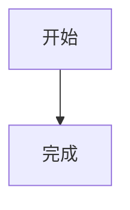

# cloverneo.com

amazing1102 的个人主页。GitHub Pages 从 main 分支的根目录构建 Jekyll，访客可以阅读文章和按栏目筛选。

## 写文章

打开主页「学习与日常」下方的「管理文章」并连接 GitHub，即可直接发布、编辑和删除文章。正文支持 Markdown 和 Mermaid，使用三个反引号加 `mermaid` 声明图表代码块。可以导入 Markdown、TXT 和 DOCX 文件，DOCX 会转换为 Markdown，文档内图片会上传到仓库。也可以从编辑器选取图片上传并插入正文。

在「已发布文章」列表点「编辑」可以修改旧文的标题、栏目、分组、摘要和正文，保存后文章地址和发布日期保持不变；点「取消编辑」回到发布新文章。编辑已发布文章时不会覆盖浏览器里的本地草稿。

发布时可以在「分组」一栏填写名称，例如 `A组`；第一次用这个名称发布即创建分组，之后它会出现在下拉选项里，同一个分组可以发布多篇。首页按分组分区展示文章，左栏有分组索引；不填分组即为「未分组」。分组不会单独建文件，名称直接写在文章的文件头 `group` 字段里。

未发布文章会自动保存在当前浏览器的 IndexedDB，重新打开主页并展开管理面板时会恢复。点击清空可清除草稿。

例如：

也可以直接在 [文章目录](https://github.com/amazing1102/amazing1102.github.io/tree/main/_posts) 中新增 `YYYY-MM-DD-slug.md`，参考已有文章的文件头。更新旧文时直接编辑原文件。栏目值为 `learn` 或 `life`；分组写在 `group` 字段（例如 `group: "A组"`），省略即为「未分组」。照片可上传到 `assets`，在正文用 Markdown 引用，如 ``。

## 管理文章

输入 GitHub Fine-grained Token 后，可以直接发布和删除文章。创建 Token 时只选择 `amazing1102/amazing1102.github.io` 这个仓库，并只授予 `Contents: Read and write` 权限。Token 只保存在当前浏览器标签页的 `sessionStorage`，关闭标签页后会清除。不要把 Token 写进文章、截图或提交到仓库。

## 改主页

首页简介和文章列表位于 `index.html`。布局位于 `_layouts`，公共样式位于 `styles.css`。资料头像取自 GitHub 账号 amazing1102，封面是 [Unsplash 工作桌照片](https://images.unsplash.com/photo-1497215728101-856f4ea42174)，均可替换为自己的图片。最初三篇文章是本站的开站文稿。

## 域名

`CNAME` 指向 cloverneo.com。在阿里云为主机记录 `@` 配置 GitHub Pages 的四条 A 记录。证书就绪后在仓库 Settings → Pages 勾选 Enforce HTTPS。[GitHub 官方说明](https://docs.github.com/zh/pages/configuring-a-custom-domain-for-your-github-pages-site/managing-a-custom-domain-for-your-github-pages-site)
