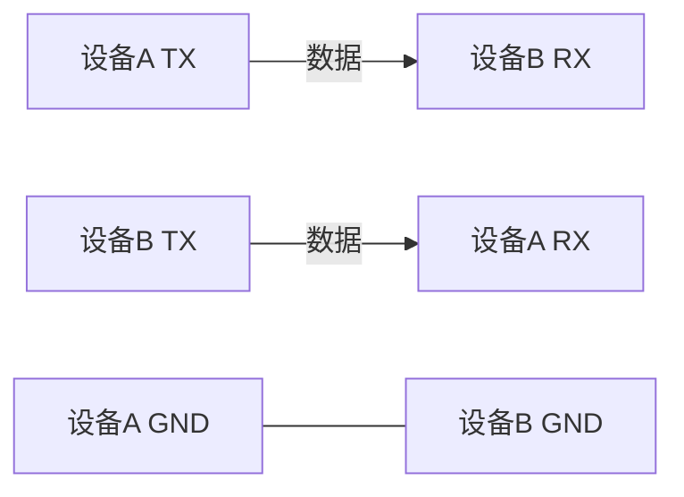
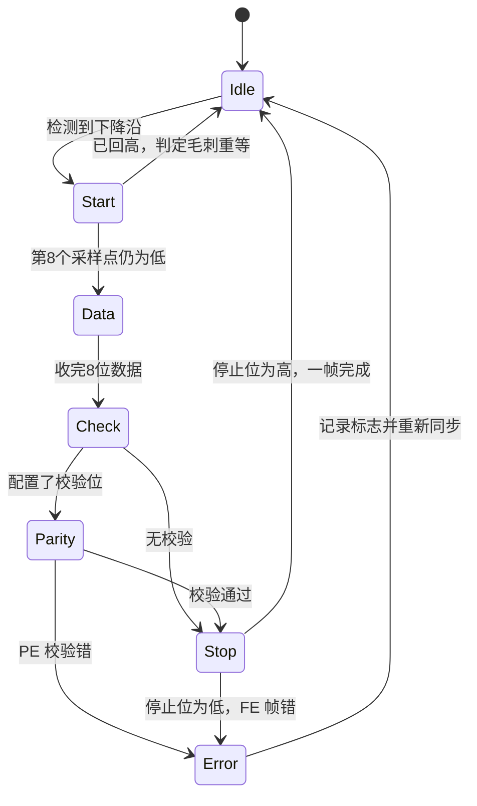
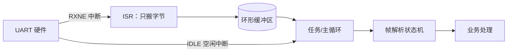

#### 

> 按「是什么 → 怎么连 → 怎么组帧 → 怎么对齐 → 怎么出错 → 怎么写代码 → 怎么选电平」过一遍，最后给 8 条必背结论。

**一、一句话本质**

UART 是**没有时钟线的异步串行通信**：双方事先约定「语速（波特率）+ 格式（帧）+ 电平（电气标准）」，靠起始位对齐时间。

- 三个约定缺一不可：波特率不一致 → 乱码；帧格式不一致 → 断句错；电平不匹配 → 收不到甚至烧接口。
- **UART 是协议层，TTL / RS-232 / RS-485 是电气层**，三者不是一回事。
- **USART = UART + 同步模式**（多一根 CK），异步用法与 UART 完全相同。

**二、物理连接：三根线 + 交叉 + 共地**

- **TX/RX 交叉**：我的嘴对你的耳。
- **必须共地**：电平是「相对 GND 的电压」，不共地就没有共同零点。
- 全双工、点对点：两条单行道，无片选无地址。

**三、帧格式：起始 + 数据 + 校验 + 停止**

`空闲高 → 起始位(低1) → 数据位(5~9，LSB 先) → 校验位(可选) → 停止位(1/1.5/2 高) → 空闲高`

| 字段   | 作用                   | 关键点                                 |
| :----- | :--------------------- | :------------------------------------- |
| 空闲   | 表示“没人说话”         | **必须为高**，否则无法用下降沿标识开始 |
| 起始位 | 1 bit 低，给接收端对表 | 一切同步的起点                         |
| 数据位 | 5~9 位，常 8 位        | **低位先发**（小端）                   |
| 校验位 | 奇/偶校验              | 只能发现奇数个比特错                   |
| 停止位 | 把线路拉回空闲高       | 留重同步余量，1/1.5/2 位               |

- 本质：**用 2 bit 开销（起止位）换掉一根时钟线**。
- 8N1 一帧 10 bit，是估时延的万能基准。

**四、波特率与误差：差一点就乱码**

- 有效吞吐 = 波特率 ÷ 帧长 × 数据位数 ÷ 8：115200 8N1 ≈ **11 520 B/s（约 11.25 KB/s）**，单字节 **86.8 µs**。
- 接收端靠自己的表逐位数，**误差逐位累积，越靠后的位越危险**——8N1 最先崩的是停止位，表现为 **FE**。
- 容差：8N1 理论上限约 **±5%**，工程只敢用一半（**±2%**）。
- 配置：`USARTDIV = fPCLK / (16 × 波特率)`，`BRR = USARTDIV × 16`（OVER8=0）；OVER8=1 时 `USARTDIV = fPCLK / (8 × 波特率)`，**BRR 仍是 16 位定点格式，只是小数位变成 3 位**。
- 晶振：11.0592 MHz = 9600 × 1152 = 115200 × 96，除以 16 仍整除，得 0 误差。
- 自测：发 **0x55 / 0xAA**（每位都跳变）能暴露失配；**0xFF 连续高电平会完全掩盖问题**。

**五、接收端怎么对齐：16 倍过采样**

起始沿 → 在**第 8/9/10 个采样点三取二**确认起始位（防毛刺）→ 之后每位同样在第 8/9/10 点采样、三取二判决。

**六、四类错误：四条排查路径**

| 标志    | 含义   | 根因                                               | 处理                                     |
| :------ | :----- | :------------------------------------------------- | :--------------------------------------- |
| **ORE** | 溢出   | RXNE 未清又收到新字节 → 新数据被丢弃，旧数据仍可读 | 加 ring buffer、上 DMA、开流控、缩短 ISR |
| **FE**  | 帧错   | 停止位采样为低 → 波特率/时钟/格式不匹配            | 查时钟源与配置，别急着重传               |
| **NE**  | 噪声错 | 三取二投票不一致 → 毛刺、地弹                      | 查走线共地、降速、加隔离                 |
| **PE**  | 校验错 | 数据在线上出错                                     | 按协议丢弃或重发                         |

口诀：**校验看数据、帧错看时序、噪声看线路、溢出看软件。**
STM32F1 上 ORE 必须**先读 SR 再读 DR** 才清，否则一直进中断。

**七、流控：发得比收得快时怎么办**

| 方式          | 机制                             | 适用               |
| :------------ | :------------------------------- | :----------------- |
| 硬件 RTS/CTS  | 接收方缓冲将满时拉 RTS，对端暂停 | 高速、小 FIFO      |
| 软件 XON/XOFF | 发送特定控制字符暂停/继续        | 可传控制字符的链路 |
| 现代做法      | 大 ring buffer + DMA             | 嵌入式最常用       |

流控只解决 **ORE**，治不了波特率失配（FE）和协议层半包。

**八、软件架构：ISR 只搬砖，任务做解析**

- ISR 里禁止：`printf`、浮点、长循环、等标志。
- 发送三选一：阻塞轮询（简单但卡 CPU）/ TXE 中断 / **DMA（大块最优）**。
- 变长帧：**DMA + IDLE** 是标配；ISR 里停 DMA、用 `NDTR` 反算长度、重启接收。
- 串口是字节流，**没有消息边界**：靠「帧头 + 长度 + CRC + 超时」自己造边界，解决半包/粘包。

**九、电气层：同一条 UART，四种嗓门**

- **TTL/CMOS**：0~3.3/5 V，板内几十厘米，最常用。
- **RS-232**：±3~±15 V 负逻辑，点对点约 15 m，需 MAX3232 转换。
- **RS-485**：差分 A/B，半双工多点，1200 m，两端 120 Ω，切方向用 **TC 中断**（用 TXE 会丢尾字节）。
- **RS-422**：差分全双工，一点对多点。

**十、USART 比 UART 多了什么**

- 同步模式：多一根 **CK**，可当简易同步串行用。
- 9 位数据模式：第 9 位作地址/校验标志，用于多机通信。
- 部分型号带 LIN / IrDA / 智能卡模式；**LPUART** 在低功耗域，32 kHz 时钟也能工作。
- 异步用法下，UART 与 USART 代码完全一样。

**十一、面试必背 8 条**

1. 无时钟线 → 起始位对齐 → 误差累积 → **停止位先崩**。
2. 自测发 **0x55/0xAA**，**0xFF 会掩盖失配**。
3. **ORE 软件慢、FE 时序错、NE 线路差、PE 数据错**。
4. **ISR 只搬砖**，解析与业务放任务里。
5. 半包/粘包靠**协议自己造边界**，不是靠“读一次就是一帧”。
6. RS-485 切方向用 **TC 中断**，不是 TXE。
7. `printf` 重定向是阻塞的，115200 下 1 KB（1024 B）≈ **89 ms**。
8. **UART 是协议，RS-232/485 是电气**，别混为一谈。
