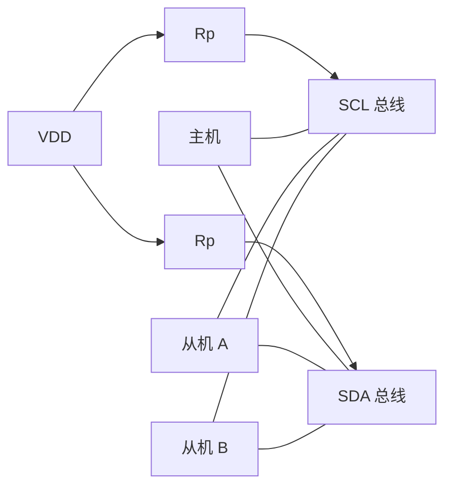
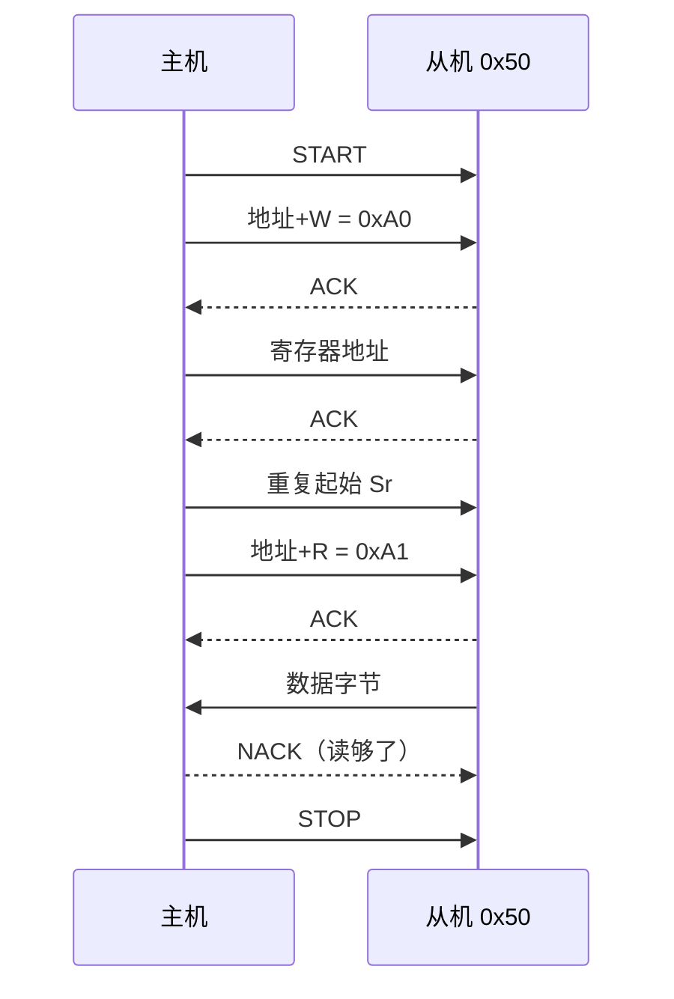
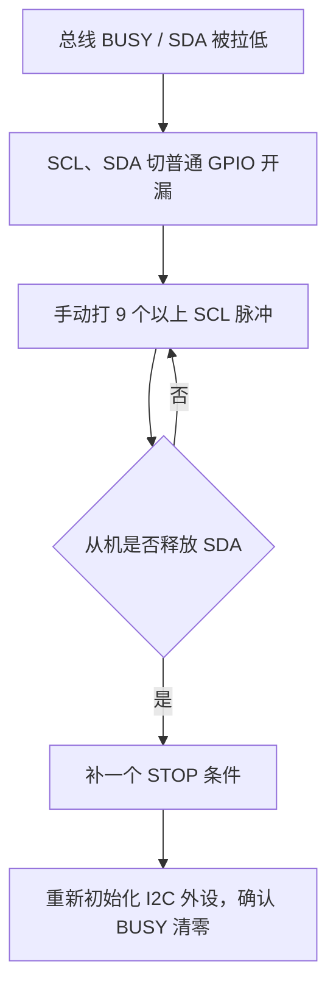

#### 1.2.1考点速查

**1. 时序四法则**：SCL 高时 SDA 下降 = 起始 S，上升 = 停止 P；SDA 只在 SCL 低时变化；每字节 **8 bit + 1 位 ACK**，**MSB 先发**。

**2. 速率与上拉**

| 模式       | 速率       | tr 上限 | 常用上拉（短总线）  |
| :--------- | :--------- | :------ | :------------------ |
| Standard   | 100 kbit/s | 1000 ns | 4.7 kΩ              |
| Fast       | 400 kbit/s | 300 ns  | 2.2 kΩ              |
| Fast Plus  | 1 Mbit/s   | 120 ns  | 约 1 kΩ             |
| High Speed | 3.4 Mbit/s | —       | 需专用主机 / 缓冲器 |

总线电容上限 **400 pF**；`Rp_max ≈ tr / (0.8473 × Cb)`，`Rp_min = (VDD − VOL) / IOL`。

**3. 地址换算**：`写 = addr7 << 1`，`读 = (addr7 << 1) | 1`；`0x50` → `0xA0` / `0xA1`。

**4. 典型帧**

```
写： S | addr+W | A | reg | A | data | A | ... | P
读： S | addr+W | A | reg | A | Sr | addr+R | A | data | N | P
```

**5. ACK 的三种含义**：从机 ACK = 收到；从机 NACK = 忙 / 无此器件；**主机 NACK = 读够了，结束接收**。

**6. 死锁恢复四步**：切 GPIO 开漏 → 打 9+ 个 SCL → 补 STOP → 复位 I²C 外设。

**7. 吞吐估算**：每字节 9 bit，`400 kHz ≈ 44 000 B/s`，`100 kHz ≈ 11 000 B/s`。

#### 1.2.2核心知识

> 按「是什么 → 为什么这样接 → 怎么通信 → 冲突怎么办 → 怎么出错 → 怎么写驱动 → 怎么选」过一遍。

**一、一句话本质**

I²C 是**两根线（SCL + SDA）+ 地址寻址**的同步串行总线：一个主机在总线上“点名”，被叫到的从机应答。

- 对比 UART：UART 无时钟、点对点；I²C 有时钟、多器件、靠地址区分。
- 对比 SPI：I²C 省线（2 根），但慢、单端、抗干扰弱。

**二、物理层：开漏 + 上拉 = 线与**



- **开漏只能拉低、不能推高**，高电平全靠上拉 → 多器件不会推挽短路。
- **线与**：任一器件拉低即低 → 这是**仲裁与时钟同步**的物理基础。
- 不接上拉：总线浮空（电平不定，通常被判为低），现象是 **BUSY 常 1 / 全 NACK / 读回 0x00**。
- 上拉计算：`Rp_max ≈ tr / (0.8473 × Cb)`，`Rp_min = (VDD − VOL) / IOL`；总线电容 **Cb ≤ 400 pF**；100 kHz 常用 4.7 kΩ，400 kHz 用 2.2 kΩ。

**三、地址：7 位 + 1 位读写**

| 操作 | 8 位字节                              | 例（7 位 0x50） |
| :--- | :------------------------------------ | :-------------- |
| 写   | addr7 左移 1 位，最低位 R/W = 0       | `0xA0`          |
| 读   | addr7 左移 1 位再加 1，最低位 R/W = 1 | `0xA1`          |

公式：`写 = addr7 << 1`，`读 = (addr7 << 1) | 1`。

坑：手册给的是 7 位还是已左移的 8 位？重复左移会变成 0x40，现象就是地址 NACK。

**四、协议四法则**

1. **起始 S**：SCL 高时 SDA 下降。
2. **停止 P**：SCL 高时 SDA 上升。
3. **数据有效**：SDA 只在 SCL 低时变化，SCL 高时必须稳定。
4. **每字节 8 bit + 1 位 ACK**，**MSB 先发**。

> 一句话记住：**考官抬头（SCL 高）你必须定格**，只有在抬头瞬间的“违规动作”才被认成起止信号。

**五、一次读寄存器的事务**



**ACK 的三种含义**（必考）：

| 场景          | 含义                           |
| :------------ | :----------------------------- |
| 从机 ACK      | 我在、收到                     |
| 从机 NACK     | 器件忙、写周期未完成、无此地址 |
| **主机 NACK** | 读够了，别再发（随后 STOP）    |

**六、多主：仲裁与时钟同步**

- 逐位比较，**发 1 却读到 0 的主机立即退出**，转为从机。
- 退出不改变总线电平 → **赢家数据无损、无需重传**，这叫**非破坏性仲裁**。
- SCL 低电平周期取所有主机中最长者 → 天然时钟同步。

**七、时钟拉伸与速率**

- 从机拉低 SCL 不放 = “我还没准备好”，主机必须等。
- **软件模拟 I²C 必须读回 SCL 实际电平**，否则会多发时钟、数据错位。
- 速率：100 k / 400 k / 1 M / 3.4 M；每字节 9 bit，**效率 88.9%**，400 kHz ≈ **44 000 B/s**。

**八、故障与总线恢复**

| 现象                  | 优先查                                                       |
| :-------------------- | :----------------------------------------------------------- |
| 全 NACK、读回 0xFF    | 地址（7/8 位）、电平转换、器件未上电；若是**上拉缺失**则总线浮空、常读回 0x00 |
| 一直 BUSY、SDA 被拉低 | **总线死锁**，走恢复流程                                     |
| 偶发 NACK             | 上拉过大、线长、电容超 400 pF、中断打断模拟时序              |
| 读多字节末字节错      | 最后一个字节主机必须回 NACK                                  |
| EEPROM 写完立刻读失败 | 写周期约 5 ms，用 **ACK polling** 等                         |

**死锁恢复四步**（从机中途复位，一直拉着 SDA）：



**九、驱动怎么写**

- **事件驱动状态机**：START → 地址 → ACK → 寄存器 → Sr → 读 → NACK → STOP，每步推进一格，绝不在 ISR 里死等。
- **每个等待都要有超时**：超时后复位外设 + 上面那套 9 时钟恢复。
- 错误码分清：**AF（ACK 失败）、BERR（总线错误）、ARLO（仲裁丢失）、OVR（溢出）**。

**十、对比：I²C / SPI / UART**

| 维度 | I²C          | SPI              | UART   |
| :--- | :----------- | :--------------- | :----- |
| 线数 | 2            | 3 + N            | 2      |
| 时钟 | 有           | 有               | 无     |
| 拓扑 | 总线，靠地址 | 一主多从，靠片选 | 点对点 |
| 速率 | 100 k~3.4 M  | 几十 MHz         | 低~中  |
| 多主 | 支持仲裁     | 不支持           | 不支持 |

**十一、必背 8 条**

1. **开漏 + 上拉 = 线与**，这是多主、仲裁、时钟同步的根。
2. SCL 高时数据必须稳，起始/停止是“高电平时的 SDA 跳变”。
3. ACK 是第 9 个时钟拉低；**主机回 NACK = 读够了**。
4. 多主仲裁**无损**：输家退出，赢家不重传。
5. 从机可拉低 SCL **时钟拉伸**，主机必须等。
6. 总线锁死：**切 GPIO → 打 9 个 SCL → 补 STOP → 复位外设**。
7. 读寄存器要先写地址，再 **Sr** 切读。
8. 上拉取值看上升沿与灌电流，**Cb 不超 400 pF**。

#### 1.2.3面试题：

##### 001. I²C 的 SCL、SDA 为什么必须用开漏输出并接上拉？不接上拉会怎样？　【极高】

**答案：** 开漏**只能拉低、不能推高**，高电平完全靠上拉电阻。

三个直接好处：① **线与**——多个器件同时驱动时只要有一个拉低总线就是低，不会推挽对推挽短路；② **多主仲裁与时钟同步**靠线与实现；③ 可跨不同电压域（上拉接各自 VDD，必要时加电平转换）。

不接上拉：总线浮空（电平不定，通常被判为低），连起始条件都发不出去，现象是 **BUSY 一直为 1 / 全 NACK / 读回 0x00**。上拉过大则上升沿变慢、高速下采错；过小则灌电流超标、功耗上升。

##### 002. 起始条件、停止条件、数据有效性的定义是什么？为什么数据位在 SCL 高电平期间必须稳定？　【极高】

**答案：**

- **起始 S**：SCL 为高时，SDA 由高变低；
- **停止 P**：SCL 为高时，SDA 由低变高；
- **数据有效**：SDA 只能在 SCL 低电平期间变化，SCL 高电平期间必须保持稳定。

原因：I²C 只有两根线，没有独立帧同步信号，只能把「SCL 高期间 SDA 跳变」这个**保留动作**定义成起止标志；若数据位也允许在 SCL 高时跳变，就无法与起止条件区分。比喻：**考官抬头（SCL 高）时你必须定格，只有抬头瞬间的“违规动作”才被认成起止信号。**

##### 003. 7 位地址怎么组成读写字节？规格书给 0x50，代码里为什么写 0xA0 / 0xA1？　【高】

**答案：** `写字节 = addr7 << 1`，`读字节 = (addr7 << 1) | 1`，最低位是 R/W。7 位 `0x50` → 写 `0xA0`、读 `0xA1`。

坑：规格书和驱动库有的直接给**已左移的 8 位地址**，你再左移一次就变成 0x40，现象是**地址 NACK、读回 0xFF**。写驱动前先确认「给的是 7 位还是 8 位」。10 位地址用 `11110xx` 前缀分两字节发，一般用不到。

##### 004. ACK 与 NACK 分别出现在哪些场景？主机读多字节时，为什么最后一个字节要回 NACK？　【高】

**答案：** 第 9 个时钟 SDA 被拉低 = ACK（收到），不拉 = NACK。

- 从机对地址 / 数据回 ACK：表示“我在、收到了”；
- 从机回 NACK：器件忙、缓冲区满、写周期未完成（EEPROM）、寄存器非法；
- **主机回 NACK**：读够最后一个字节时告诉从机“别再发了”，随后发 STOP。

若最后一个字节回 ACK，从机会继续驱动 SDA 发送下一字节，此时主机发 STOP 就与从机数据冲突，可能**总线锁死、SDA 卡低**。也有主机最后回 NACK 后不发 STOP，直接发重复起始 Sr。

##### 005. 总线一直 BUSY、SDA 被拉低不放，连起始条件都发不出去，怎么恢复？　【极高】

**答案：** 典型 I²C 死锁——从机在传输中途被复位或掉电，仍卡在等第 9 个时钟，一直拉着 SDA。恢复步骤：

1. 把 SCL、SDA 切成**普通 GPIO 开漏**；
2. 手动输出 **9 个以上 SCL 脉冲**，让从机把剩余位吐完并释放 SDA；
3. 确认 SDA 变高后，补一个 **STOP**（SCL 高时 SDA 上升）；
4. 重新初始化 I²C 外设，读状态寄存器确认 BUSY 已清。

工程上必须加**超时保护**：卡死时不复位外设会拖死整机；必要时给从机留一根复位控制脚。

##### 006. 上拉电阻怎么选？总线电容 400 pF 的限制意味着什么？偶发 NACK 和它有关吗？　【高】

**答案：**

```
Rp_max ≈ tr / (0.8473 × Cb)     ← 上升沿不能太慢
Rp_min = (VDD − VOL) / IOL      ← 拉低时灌电流不能超标
```

- 标准模式 tr ≤ 1000 ns、快速模式 tr ≤ 300 ns；总线电容 **Cb ≤ 400 pF**（线长 + 器件输入电容 + 走线电容）。
- 典型：短总线 100 kHz 用 **4.7 kΩ**；400 kHz 用 **2.2 kΩ** 或更小。
- **上拉过大 + 线长** → 上升沿变圆、高电平时间不足 → 偶发 NACK、偶发数据错、高速下必挂；上拉过小 → 灌电流超限、功耗上升。
- 器件多或走线长，用 **I²C 缓冲器 / 中继器（如 PCA9515）** 分段，别一味减小上拉。

##### 007. 多主机时总线怎么仲裁？为什么说 I²C 的仲裁是“无损”的？　【中高】

**答案：**

- 所有主机在 SCL 低时各自改变 SDA，实际电平由**线与**决定；
- 某主机想发 1，却读到 SDA 为 0 → 说明有别人在发 0，它**立即退出**并转为从机；
- 时钟同步：SCL 低电平周期取所有主机中**最长**的那个，天然同步。

**无损**：退出发生在数据位比较上，赢家发出的位没有被破坏，总线无需重传，输家可在总线空闲后重新发起。这也是 I²C 比 SPI 更适合多主场景的根本原因（SPI 无仲裁，多主只能靠外部逻辑）。

##### 008. 时钟拉伸（Clock Stretching）是什么？软件模拟 I²C 为什么必须读回 SCL 的实际电平？　【中高】

**答案：**

- 从机拉低 SCL 不放 = “我还没准备好，等一下”，主机必须等它释放才能继续打时钟；常见于 ADC 转换、EEPROM 写、传感器测量期间。
- 模拟 I²C 的坑：若按“我写了高，SCL 就是高”推进时序，遇到拉伸会**多发时钟、数据错位**。正确做法是**驱动 SCL 为高后读回引脚电平**，确实读到高才继续。
- 硬件 I²C 多数支持拉伸，但要注意：部分 MCU 的 I²C 有超时或对长时间拉伸兼容性差；也有从机在 STOP 后仍短时拉低 SCL。

##### 009. I²C 通信全 NACK、读回 0xFF，你的排查顺序是什么？　【极高】

**答案：** 按「软件 → 电气 → 器件」三层排：

1. **地址**：7 位 / 8 位是否混淆（0x50 vs 0xA0），是否重复左移；
2. **配置**：外设时钟使能、引脚是否真的复用成 I²C、速率是否超器件上限；
3. **上拉与电平**：上拉有没有焊、阻值是否过大、3.3 V 主控对 5 V 器件是否做了电平转换；
4. **器件**：供电、复位脚、地址引脚接法、是否正处于写周期（EEPROM 约 5 ms，用 **ACK polling** 轮询）；
5. **波形**：起始条件是否成立、第 9 个时钟的 ACK 位、上升沿是否变圆。

读回 0xFF 通常就是 SDA 被上拉保持高、根本没有器件应答。

##### 010. I²C 和 SPI 怎么选？I²C 为什么速度上不去？　【极高】

**答案：**

- 选型：器件多、要省引脚、速率要求低 → **I²C**；要高速（屏幕、Flash、大数据量 ADC）→ **SPI**。
- I²C 慢的三个原因：① **开漏 + 上拉 RC**，上升沿慢，速率受总线电容限制；② 每字节都有 **ACK 开销**（9 bit 传 8 bit，效率 88.9%）；③ 协议开销（地址、起止）与**时钟拉伸**。
- SPI 是推挽输出、无 ACK、无地址，可跑几十 MHz，但要为每个从机多一根 CS，且不支持多主仲裁。
