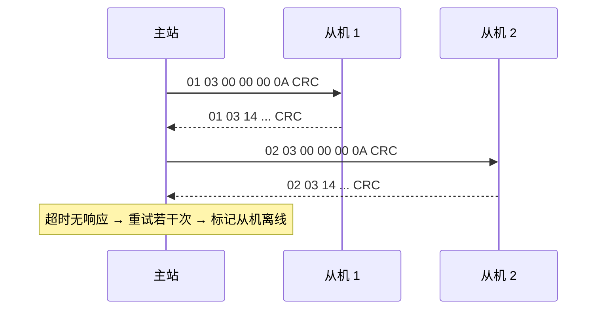
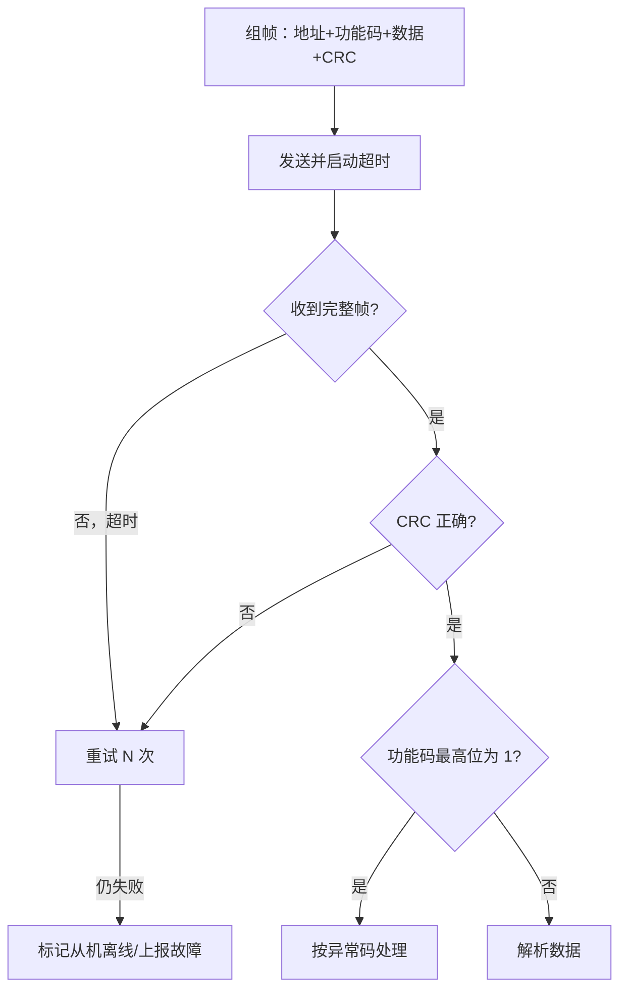

##### 考点速查

**1. 一句话**：Modbus-RTU 是**主从、请求-响应、二进制帧**的串口协议；从机地址 1~247，帧尾 **CRC16**，帧与帧靠 **3.5 字符时间**分隔。

**2. 帧结构**：`地址(1B) + 功能码(1B) + 数据(N B) + CRC16(2B)`；最大 ADU **256 字节**；**CRC 低字节先发**。

**3. 主从规则**：一主多从，从机**不能主动发**；地址 **0 = 广播**（从机执行但不回），**248~255 保留**。

**4. 四种数据表**

| 数据表                          | 对象         | 读/写命令    |
| :------------------------------ | :----------- | :----------- |
| 线圈（Coils）                   | 可读写位     | 01 / 05 / 0F |
| 离散输入（Discrete Inputs）     | 只读位       | 02           |
| 保持寄存器（Holding Registers） | 可读写 16 位 | 03 / 06 / 10 |
| 输入寄存器（Input Registers）   | 只读 16 位   | 04           |

**5. 常用功能码**：01 读线圈、02 读离散输入、03 读保持寄存器、04 读输入寄存器、05 写单线圈、06 写单寄存器、0F 写多线圈、10 写多寄存器。

**6. 异常响应**：功能码 **+0x80** + 异常码；01 非法功能、02 非法地址、03 非法数据值、04 从机故障、06 从机忙。

**7. 时间规则**：**帧间隔 ≥ 3.5 字符**，帧内字符间隔 **≤ 1.5 字符**；波特率 > 19200 时用固定 **1750 µs / 750 µs**。

**8. 故障速判**：无响应（地址 / 波特率 / 接线 / DE 方向）｜CRC 错（干扰、字节错位、CRC 高低字节反）｜数据不对（寄存器地址偏移、字节序、32 位字序）｜偶发超时（3.5 字符定时不准、总线负载高）。

##### 核心知识

> 按「是什么 → 电气 → 帧 → 时间 → 功能码 → 报文 → 异常 → CRC → 轮询 → 调试」过一遍。

**一、一句话本质**

Modbus-RTU 是**主从问答**协议：**主站发请求，从站回响应**，从站永不主动开口。

- 它只管“读/写哪张表的哪个地址”，**不管物理层**——可跑 RS-485、RS-232，也能封装进 TCP。
- 简单到可以手写实现，所以工业现场到处都是。

**二、物理层**

- 最常见 **RS-485 半双工**：A/B 差分、两端 120 Ω、失效安全偏置、**DE 方向控制**。
- 也可跑 RS-232（点对点）。
- 一主多从：从机地址 **1~247**，**0 是广播**（从机执行但不回应），248~255 保留。

**三、帧结构：ADU 与 PDU**


- **PDU** = 功能码 + 数据；**ADU** = 地址 + PDU + CRC。
- **RTU 是二进制**；**ASCII 模式**把每个字节拆成两个 ASCII 字符并加 LRC，可读但效率低。
- 一帧最大 **256 字节**。

**四、时间规则：3.5 个字符**

- 一个字符按 **11 位**算（起始 + 8 数据 + 校验 + 停止）；8N1 时可近似按 10 位，但实现上常按 11 位留余量。
- `t1.5 = 1.5 × 11 / 波特率`，`t3.5 = 3.5 × 11 / 波特率`。
- 9600 bps：t3.5 ≈ **4.0 ms**；19200 bps：≈ **2.0 ms**。
- 波特率 **> 19200** 时，规范建议用固定值：**t3.5 = 1750 µs，t1.5 = 750 µs**。
- 实现方式：**串口 IDLE 中断 + 定时器**，或 **DMA + 超时判帧**。

**五、功能码与数据模型**

| 功能码 | 作用         | 数据单位 |
| :----- | :----------- | :------- |
| 01     | 读线圈       | 位       |
| 02     | 读离散输入   | 位       |
| 03     | 读保持寄存器 | 16 位    |
| 04     | 读输入寄存器 | 16 位    |
| 05     | 写单线圈     | 位       |
| 06     | 写单寄存器   | 16 位    |
| 0F     | 写多线圈     | 位       |
| 10     | 写多寄存器   | 16 位    |

- **PLC 地址与协议地址差 1**：`40001` 对应协议地址 `0x0000`，是现场最常见的“读错地址”原因。
- 读位时响应按**字节打包**，从 LSB 开始。

**六、典型报文**

```
读保持寄存器（从 0x0000 读 10 个）：
  01 03 00 00 00 0A C5 CD
  响应：01 03 14 <20 字节数据> <CRC>      ← 0x14 = 20 字节

写单寄存器（0x0001 写 0x0064）：
  01 06 00 01 00 64 <CRC>

写多寄存器（从 0x0000 写 2 个）：
  01 10 00 00 00 02 04 <4 字节> <CRC>

异常响应（读保持寄存器、地址非法）：
  01 83 02 <CRC>
```

**七、异常响应**

- 格式：**功能码 + 0x80**，后跟 1 字节异常码。
- 常见异常码：**01 非法功能、02 非法地址、03 非法数据值、04 从机故障、06 从机忙**。
- 主站看到 `0x80` 应立即按异常码处理，不要当正常数据解析。

**八、CRC16**

- 多项式 `0x8005`（反向实现用 `0xA001`），初值 `0xFFFF`，**无最终异或**。
- 参与计算的是**除 CRC 外的全部字节**：地址 + 功能码 + 数据。
- **发送时低字节在前**（低字节、高字节）。
- 常见坑：CRC 高低字节写反、计算时漏掉地址或功能码。

**九、主从轮询**





- 主站按**调度表轮询**，从机之间共享总线，**同一时刻只能有一个在说**。
- 广播写（地址 0）：所有从机执行，**都不回应**。

**十、调试**

| 现象            | 优先查                                              |
| :-------------- | :-------------------------------------------------- |
| 从机完全不响应  | 地址/波特率/校验位、A/B 是否接反、DE 方向、终端电阻 |
| CRC 错          | 干扰、字节错位、CRC 高低字节反、帧被截断            |
| 从机回异常码 02 | 寄存器地址越界、PLC 地址与协议地址差 1              |
| 数据对不上      | 字节序、32 位数据的字序（ABCD/CDAB）、寄存器映射    |
| 偶发超时        | 3.5 字符定时不准、总线负载高、从机响应慢            |
| 多从机冲突      | 两个从机地址相同、DE 未及时释放                     |

- 工具：串口助手（发十六进制）、Modbus 调试软件、逻辑分析仪抓 A/B 波形。

**十一、对比：RTU / ASCII / TCP**

| 维度   | Modbus-RTU       | Modbus-ASCII  | Modbus-TCP     |
| :----- | :--------------- | :------------ | :------------- |
| 编码   | 二进制           | ASCII 字符    | 二进制         |
| 校验   | **CRC16**        | LRC           | 无（TCP 保证） |
| 帧分隔 | **3.5 字符时间** | 冒号/回车换行 | MBAP 头长度    |
| 速率   | 高               | 低            | 高             |
| 典型   | RS-485 现场总线  | 老设备、调试  | 以太网         |

**十二、必背 8 条**

1. **主从问答**：主站请求、从站响应，从站永不主动。
2. 帧 = **地址 + 功能码 + 数据 + CRC16**，CRC **低字节先发**。
3. **帧间隔 3.5 字符**是 RTU 的“分帧手段”，>19200 用固定 1750 µs。
4. 四种表：**线圈、离散输入、保持寄存器、输入寄存器**。
5. **PLC 地址 40001 = 协议地址 0x0000**，差 1。
6. 异常响应 = **功能码 + 0x80** + 异常码。
7. CRC16：**0xA001、初值 0xFFFF、低字节先发**。
8. 现场三把刀：**量 A/B 波形、查地址与波特率、看 CRC 是否反了**。

##### 面试题：

###### 001. Modbus-RTU 的帧格式是什么？为什么用 CRC16 而不是简单校验和？　【极高】

**答案：** 帧 = **地址（1 B）+ 功能码（1 B）+ 数据（N B）+ CRC16（2 B）**，最大 256 字节。

- **PDU** = 功能码 + 数据；**ADU** = 地址 + PDU + CRC。
- **CRC 低字节先发**，参与计算的是“除 CRC 外的所有字节”。
- 用 CRC16 的原因：**16 位检错能力远强于 8 位校验和**，能发现绝大多数单/双位错和突发错误，且计算简单、无需握手，适合半双工轮询。

###### 002. 3.5 字符时间怎么算？为什么需要它？波特率高于 19200 怎么办？　【极高】

**答案：** RTU 帧**没有长度字段、也没有起始符**，只能靠“**总线静默时间**”判断一帧结束——这就是 3.5 字符的由来。

- 字符按 **11 位**算：`t3.5 = 3.5 × 11 / 波特率`；
- 9600 bps 时 ≈ **4.0 ms**，19200 bps 时 ≈ **2.0 ms**；
- 帧内字符间隔不能超过 **1.5 字符**，否则会被判为断帧；
- 波特率 **> 19200** 时，规范建议用固定值 **t3.5 = 1750 µs、t1.5 = 750 µs**。

实现上常用 **串口 IDLE 中断 + 定时器**，或 **DMA + 超时判帧**。

###### 003. 常用功能码有哪些？四种数据表怎么对应？　【极高】

**答案：**

| 功能码       | 作用                         | 数据表                     |
| :----------- | :--------------------------- | :------------------------- |
| 01 / 05 / 0F | 读线圈 / 写单线圈 / 写多线圈 | 线圈（可读写位）           |
| 02           | 读离散输入                   | 离散输入（只读位）         |
| 03 / 06 / 10 | 读 / 写单 / 写多保持寄存器   | 保持寄存器（可读写 16 位） |
| 04           | 读输入寄存器                 | 输入寄存器（只读 16 位）   |

**地址映射坑**：PLC 习惯写 `40001`，对应协议地址是 `0x0000`，**差 1**，这是现场“读错地址/回异常码 02”的头号原因。

###### 004. 异常响应的格式是什么？常见异常码有哪些？　【高】

**答案：** 异常响应 = **功能码 + 0x80**，后跟 1 字节异常码。

常见异常码：

- **01** 非法功能码；
- **02** 非法数据地址；
- **03** 非法数据值（数量/参数越界）；
- **04** 从机设备故障；
- **05** 确认（执行中）；
- **06** 从机忙。

主站识别到最高位为 1 就应按异常处理，**不能当正常数据解析**。

###### 005. 读保持寄存器（03）的请求和响应报文举例？　【高】

**答案：** 从地址 1 的从机、起始 0x0000 读 10 个寄存器：

```
请求：01 03 00 00 00 0A C5 CD
      │  │  └─┬─┘ └─┬─┘ └─┬─┘
      │  │    │     │     └ CRC16（低字节 C5 在前）
      │  │    │     └ 寄存器数量 10
      │  │    └ 起始地址 0x0000
      │  └ 功能码 03
      └ 从机地址 01

响应：01 03 14 <20 字节数据> <CRC>
      └ 0x14 = 20 字节（10 个寄存器 × 2）
```

###### 006. CRC16 怎么算？为什么低字节先发？　【中高】

**答案：**

- 算法：多项式 `0x8005`（反向实现用 **0xA001**）、初值 **0xFFFF**、无最终异或；
- 对“地址 + 功能码 + 数据”逐字节计算；
- 结果 **低字节先发、高字节后发**。

原因：这是 **Modbus 规范规定的传输顺序**（CRC 按 LSB first 发送）。注意它和**寄存器数据“高字节先发”是不同的**，两个方向混了就是经典 bug。

###### 007. 从机完全不响应，你的排查顺序是什么？　【极高】

**答案：** 从“电、线、参数、时序”四层排：

1. **参数**：从机地址、波特率、数据位/校验/停止位是否一致；
2. **接线**：A/B 是否接反、是否共地、终端电阻与偏置；
3. **方向**：RS-485 的 **DE 是否及时切换**（发完必须释放，否则收不到响应）；
4. **从机**：是否上电、是否处于故障/忙状态；
5. **波形**：用逻辑分析仪看**请求有没有到从机**、从机有没有回；
6. **软件**：主站是否在 3.5 字符后才发下一帧、超时是否设得太短。

分段法：先确认“请求到没到”，再确认“从机回没回”，能快速定位是主站、总线还是从机的问题。

###### 008. CRC 错误偶发，怎么定位？　【高】

**答案：**

- **物理层**：线长、干扰、终端电阻缺失、屏蔽/接地不良；
- **字节错位**：多收/漏收字节、帧被截断（3.5 字符判断不准）；
- **实现错误**：CRC 高低字节写反、计算范围漏了地址或功能码；
- **时序**：从机响应还没发完，主站就以为帧结束；
- **对比法**：用抓包工具对照“原始字节”和“自己算的 CRC”，能立刻区分是**收到错**还是**算错**。

###### 009. 读回来的数据不对、像是字节序反了，怎么查？　【高】

**答案：** 按可能性排：

1. **寄存器地址偏移**：PLC 地址 `40001` vs 协议地址 `0x0000`（差 1）；
2. **32 位数据字序**：两个寄存器拼 32 位时有 **ABCD / CDAB** 两种约定，必须和从机手册一致；
3. **位打包顺序**：读线圈/离散输入时按字节打包、**LSB 先**；
4. **功能码用错**：`03`（保持寄存器）与 `04`（输入寄存器）读的是不同的表；
5. **数据类型**：有符号/无符号、定点小数缩放没处理。

###### 010. Modbus-RTU 和 Modbus-TCP 有什么区别？网关怎么转换？　【中高】

**答案：**

| 维度 | RTU              | TCP                      |
| :--- | :--------------- | :----------------------- |
| 承载 | RS-485/232       | 以太网 TCP，端口 **502** |
| 校验 | **CRC16**        | 无（TCP 保证）           |
| 分帧 | **3.5 字符时间** | **MBAP 头**里的长度字段  |
| 地址 | 1 字节从机地址   | 单元标识（Unit ID）      |

网关转换要点：**去掉/添加 CRC**、把 RTU 的从机地址映射到 MBAP 的 Unit ID、处理**超时与重试**、做**请求-响应配对**（TCP 是并发连接，串口是严格一问一答）。
