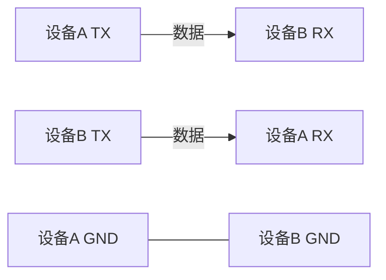
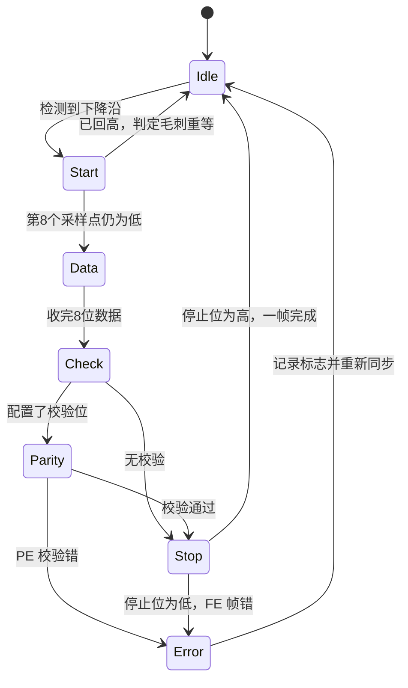

#### 考点速查

**1. 吞吐估算（8N1 = 10 bit/字节）**

| 波特率 | 单字节耗时 | 有效吞吐   |
| :----- | :--------- | :--------- |
| 9600   | 1.04 ms    | 960 B/s    |
| 115200 | 86.8 µs    | 11.25 KB/s |

**2. 误差预算**：无时钟线 → 误差逐位累积，8N1 理论上限约 ±5%，工程控制在 **±2%**；11.0592 MHz = 9600 × 1152，可整除得 0 误差（8051 时代设计）。

**3. 电气层**

| 标准     | 电平                   | 拓扑               | 距离        |
| :------- | :--------------------- | :----------------- | :---------- |
| TTL/CMOS | 0 ~ 3.3/5 V            | 点对点             | 板内几十 cm |
| RS-232   | ±3 ~ ±15 V，负逻辑     | 点对点             | 约 15 m     |
| RS-485   | 差分 A/B，±200 mV 判决 | 多点、半双工       | 1200 m      |
| RS-422   | 差分                   | 一点对多点、全双工 | 1200 m      |

#### 核心知识

> 按「是什么 → 怎么连 → 怎么组帧 → 怎么对齐 → 怎么出错 → 怎么写代码 → 怎么选电平」过一遍，最后给 8 条必背结论。

**一、一句话本质**

UART 是**没有时钟线的异步串行通信**：双方事先约定「语速（波特率）+ 格式（帧）+ 电平（电气标准）」，靠起始位对齐时间。

- 三个约定缺一不可：波特率不一致 → 乱码；帧格式不一致 → 断句错；电平不匹配 → 收不到甚至烧接口。
- **UART 是协议层，TTL / RS-232 / RS-485 是电气层**，三者不是一回事。
- **USART = UART + 同步模式**（多一根 CK），异步用法与 UART 完全相同。

**二、物理连接：三根线 + 交叉 + 共地**



- **TX/RX 交叉**：我的嘴对你的耳。
- **必须共地**：电平是「相对 GND 的电压」，不共地就没有共同零点。
- 全双工、点对点：两条单行道，无片选无地址。

**三、帧格式：起始 + 数据 + 校验 + 停止**

`空闲高 → 起始位(低1) → 数据位(5~9，LSB 先) → 校验位(可选) → 停止位(1/1.5/2 高) → 空闲高`

| 字段   | 作用                   | 关键点                                 |
| :----- | :--------------------- | :------------------------------------- |
| 空闲   | 表示“没人说话”         | **必须为高**，否则无法用下降沿标识开始 |
| 起始位 | 1 bit 低，给接收端对表 | 一切同步的起点                         |
| 数据位 | 5~9 位，常 8 位        | **低位先发**（小端）                   |
| 校验位 | 奇/偶校验              | 只能发现奇数个比特错                   |
| 停止位 | 把线路拉回空闲高       | 留重同步余量，1/1.5/2 位               |

- 本质：**用 2 bit 开销（起止位）换掉一根时钟线**。
- 8N1 一帧 10 bit，是估时延的万能基准。

**四、波特率与误差：差一点就乱码**

- 有效吞吐 = 波特率 ÷ 帧长 × 数据位数 ÷ 8：115200 8N1 ≈ **11 520 B/s（约 11.25 KB/s）**，单字节 **86.8 µs**。
- 接收端靠自己的表逐位数，**误差逐位累积，越靠后的位越危险**——8N1 最先崩的是停止位，表现为 **FE**。
- 容差：8N1 理论上限约 **±5%**，工程只敢用一半（**±2%**）。
- 配置：`USARTDIV = fPCLK / (16 × 波特率)`，`BRR = USARTDIV × 16`（OVER8=0）；OVER8=1 时 `USARTDIV = fPCLK / (8 × 波特率)`，**BRR 仍是 16 位定点格式，只是小数位变成 3 位**。
- 晶振：11.0592 MHz = 9600 × 1152 = 115200 × 96，除以 16 仍整除，得 0 误差。
- 自测：发 **0x55 / 0xAA**（每位都跳变）能暴露失配；**0xFF 连续高电平会完全掩盖问题**。

**五、接收端怎么对齐：16 倍过采样**

起始沿 → 在**第 8/9/10 个采样点三取二**确认起始位（防毛刺）→ 之后每位同样在第 8/9/10 点采样、三取二判决。



**六、四类错误：四条排查路径**

| 标志    | 含义   | 根因                                               | 处理                                     |
| :------ | :----- | :------------------------------------------------- | :--------------------------------------- |
| **ORE** | 溢出   | RXNE 未清又收到新字节 → 新数据被丢弃，旧数据仍可读 | 加 ring buffer、上 DMA、开流控、缩短 ISR |
| **FE**  | 帧错   | 停止位采样为低 → 波特率/时钟/格式不匹配            | 查时钟源与配置，别急着重传               |
| **NE**  | 噪声错 | 三取二投票不一致 → 毛刺、地弹                      | 查走线共地、降速、加隔离                 |
| **PE**  | 校验错 | 数据在线上出错                                     | 按协议丢弃或重发                         |

口诀：**校验看数据、帧错看时序、噪声看线路、溢出看软件。**
STM32F1 上 ORE 必须**先读 SR 再读 DR** 才清，否则一直进中断。

**七、流控：发得比收得快时怎么办**

| 方式          | 机制                             | 适用               |
| :------------ | :------------------------------- | :----------------- |
| 硬件 RTS/CTS  | 接收方缓冲将满时拉 RTS，对端暂停 | 高速、小 FIFO      |
| 软件 XON/XOFF | 发送特定控制字符暂停/继续        | 可传控制字符的链路 |
| 现代做法      | 大 ring buffer + DMA             | 嵌入式最常用       |

流控只解决 **ORE**，治不了波特率失配（FE）和协议层半包。

**八、软件架构：ISR 只搬砖，任务做解析**


- ISR 里禁止：`printf`、浮点、长循环、等标志。
- 发送三选一：阻塞轮询（简单但卡 CPU）/ TXE 中断 / **DMA（大块最优）**。
- 变长帧：**DMA + IDLE** 是标配；ISR 里停 DMA、用 `NDTR` 反算长度、重启接收。
- 串口是字节流，**没有消息边界**：靠「帧头 + 长度 + CRC + 超时」自己造边界，解决半包/粘包。

**九、电气层：同一条 UART，四种嗓门**

- **TTL/CMOS**：0~3.3/5 V，板内几十厘米，最常用。
- **RS-232**：±3~±15 V 负逻辑，点对点约 15 m，需 MAX3232 转换。
- **RS-485**：差分 A/B，半双工多点，1200 m，两端 120 Ω，切方向用 **TC 中断**（用 TXE 会丢尾字节）。
- **RS-422**：差分全双工，一点对多点。

**十、USART 比 UART 多了什么**

- 同步模式：多一根 **CK**，可当简易同步串行用。
- 9 位数据模式：第 9 位作地址/校验标志，用于多机通信。
- 部分型号带 LIN / IrDA / 智能卡模式；**LPUART** 在低功耗域，32 kHz 时钟也能工作。
- 异步用法下，UART 与 USART 代码完全一样。

**十一、面试必背 8 条**

1. 无时钟线 → 起始位对齐 → 误差累积 → **停止位先崩**。
2. 自测发 **0x55/0xAA**，**0xFF 会掩盖失配**。
3. **ORE 软件慢、FE 时序错、NE 线路差、PE 数据错**。
4. **ISR 只搬砖**，解析与业务放任务里。
5. 半包/粘包靠**协议自己造边界**，不是靠“读一次就是一帧”。
6. RS-485 切方向用 **TC 中断**，不是 TXE。
7. `printf` 重定向是阻塞的，115200 下 1 KB（1024 B）≈ **89 ms**。
8. **UART 是协议，RS-232/485 是电气**，别混为一谈。

#### 面试题：

##### 001. 一帧 UART 数据由哪些部分组成？为什么必须有起始位和停止位，且空闲必须是高电平？　【极高】

**答案：** 空闲高 → 起始位（1 bit 低）→ 数据位（5~9 位，常 8 位，**LSB 先发**）→ 校验位（可选）→ 停止位（1 / 1.5 / 2 位高）。

```
        ┌──────── 一帧（8N1 = 1+8+1 = 10 bit）────────┐
空闲高  │ 起始位↓ │ D0 D1 D2 D3 D4 D5 D6 D7 │ 停止位↑ │ 空闲高
        └──────────────────────────────────────────────┘
          1 bit            8 bit（LSB 先发）        1 bit
```

UART 没有时钟线，收发双方只能靠**起始位的下降沿对齐时基**、靠**停止位把线路拉回空闲高**为下一帧做准备——本质是**用 2 bit 的开销换取自同步**。空闲必须为高，否则无法用“第一个下降沿”唯一标识“开始说话”。

##### 002. APB 时钟 72 MHz、115200 8N1、16 倍过采样，USARTDIV 与 BRR 怎么算？实际误差多少？OVER8=1 时有何不同？　【高】

**答案：**

- `USARTDIV = 72e6 / (16 × 115200) = 39.0625`
- `BRR = 39.0625 × 16 = 625 = 0x271`（尾数 39，小数 1），**误差为 0**
- 通用式：`误差 = (实际波特率 − 目标波特率) / 目标波特率`，实际值由 BRR 反算
- **OVER8=1（8 倍过采样）**：`USARTDIV = fPCLK / (8 × baud)`，内部只需 8 倍时钟，同样 fPCLK 下可跑更高波特率；代价是采样点更稀、小数位只有 3 bit，精度与抗噪变差
- 追问：BRR 不能整除时误差会累积到停止位，**先表现为 FE（帧错误）**

##### 003. 产品常温通信正常，高低温老化时偶发帧错误（FE），代码和板子都没动，为什么？　【中】

**答案：** 根因是**时钟源精度**。用内部 HSI（出厂仅在 25 ℃ 校准，全温区偏差可达 ±2%~±3%）时，频偏与 BRR 小数误差一起吃掉了 8N1 那 **2% 的误差预算**，高低温下停止位采样点漂移，于是报 FE。

解法：改 **HSE 外部晶振**；降低波特率；换带**自动波特率检测 / LPUART** 的型号；协议层加重发与错误计数。排查时把时钟输出到 MCO，用示波器/频率计实测。

##### 004. 串口助手收到的全是乱码，请给出你的排查顺序。　【极高】

**答案：** 从软件到硬件分层排查：

1. **配置**：波特率、数据位、校验、停止位、流控是否一致
2. **时钟**：实际 fPCLK 是否等于代码假设（分频系数、HSE 是否起振），是否被低功耗/看门狗改动
3. **接线**：TX/RX 是否交叉、**是否共地**、电平 3.3 V 还是 5 V、RS-232 是否经 MAX3232
4. **波形**：示波器看起始位宽度、位宽、有无过冲与振铃
5. **干扰**：线长、屏蔽/双绞、光耦或隔离

关键动作：发 **0x55 / 0xAA** 图样，能立刻区分“配错”和“干扰”；发 0xFF 会掩盖问题，测了等于没测。

##### 005. 串口偶尔丢字节，怎么判断是 ORE、FE、NE 还是 PE？各自怎么处理？　【高】

**答案：** 读状态寄存器逐位判定，四类根因完全不同：

| 标志    | 全称          | 根因                                               | 处理                                           |
| :------ | :------------ | :------------------------------------------------- | :--------------------------------------------- |
| **ORE** | Overrun Error | RXNE 未清又收到新字节 → 新数据被丢弃，旧数据仍可读 | 加大 ring buffer、改 DMA、开 RTS/CTS、缩短 ISR |
| **FE**  | Framing Error | 预期停止位处未读到高，波特率/时钟/帧格式不匹配     | 查时钟源与配置，别急着重传                     |
| **NE**  | Noise Error   | 三取二投票不一致，线路毛刺、地弹                   | 查走线与共地、降速、加隔离                     |
| **PE**  | Parity Error  | 奇偶校验不符，数据在线上出错                       | 按协议丢弃或请求重发                           |

口诀：**校验看数据、帧错看时序、噪声看线路、溢出看软件。**
STM32F1 上 ORE 必须**先读 SR 再读 DR** 才能清除，否则会一直进中断——真实存在的死循环坑。

##### 006. 把 `printf` 重定向到串口后，程序变慢甚至中断里卡死，为什么？怎么改？　【高】

**答案：** 典型实现是**阻塞轮询发字节**：115200 8N1 下 1 KB（1024 B）约 **89 ms**，放在中断或高频任务里必然超时、丢中断、喂不上狗。

改进：① ISR 只把数据丢进**环形缓冲区**，发送用 **TXE 中断或 DMA**；② 日志分级编译开关，量产关闭；③ 注意 `printf` 不可重入，浮点格式显著增大 Flash 占用和耗时。

判断标准：**任何在中断里调用、且耗时随数据量增长的函数，都是隐患。**

##### 007. 变长帧怎么收？说说 IDLE 中断 + DMA 的实现要点和坑。　【极高】

**答案：** DMA 负责搬字节，总线空闲一个字符时间触发 **IDLE**，表示“本帧结束”。

- 开接收前**先清 IDLE 标志**，否则一使能就立刻多进一次中断
- IDLE 里**先停 DMA**，用 `NDTR` 反算已收长度，把缓冲交给解析任务，再重装重启
- 处理 **IDLE 与 DMA 传输完成（TC）的竞争**，两者可能同时到达
- 两次 IDLE 之间可能只是**半包**（上位机分包发送），要配合超时或长度字段
- 长数据用**双缓冲 / 乒乓缓冲**，避免解析时被 DMA 覆盖
- F1 系列 IDLE 靠“读 SR 再读 DR”清除，F4/F7 走 `ICR` 的 `IDLECF`

##### 008. 串口是字节流，如何设计协议解决半包、粘包？　【高】

**答案：** 边界必须由协议自己造，标准四件套：

1. **帧头 + 长度字段 + 载荷 + CRC + 帧尾**
2. **超时断帧**兜底（Modbus 为 3.5 个字符时间）
3. **CRC / 校验**丢错误帧，**ACK / 重发 + 序号**去重
4. 状态机解析：找头 → 收长度 → 收载荷 → 校验 → 交付；任何时刻收到非法帧头就**重新找头**

补充：长度字段必须有上限校验，防止错误数据撑爆缓冲；解析器要能同时处理“一次多帧”和“一帧分多次到达”。

##### 009. RS-485 半双工，为什么有时最后 1~2 个字节丢失，或者主机收到自己发出去的数据？　【中高】

**答案：**

- **丢尾字节**：用 TXE（发送寄存器空）就拉低 DE，最后一个字节还在移位寄存器里就被截断。正确做法是用 **TC（传输完成）中断后再切方向**，或等足 1 个字符时间
- **收到自己的回显**：半双工总线本地接收端也会听到自己发的数据，发送期间应**屏蔽 / 丢弃接收**，或按协议过滤
- 另外两点：**120 Ω 终端电阻只装总线两端**，中间节点不装；总线空闲要有**失效安全偏置**，否则空闲差分电压接近 0 会误判；长线要共地或做隔离，切换后留出总线释放时间

##### 010. UART、SPI、I²C 怎么选？UART 为什么天生不能多机？有什么补救办法？　【极高】

**答案：**

- 选型一句话：**UART 简单、能跑远（配 485 可达千米）、只能点对点；SPI 最快、线多、靠片选扩展；I²C 省线、靠地址组网、速度低**
- UART 无片选、无地址，输出是**推挽对推挽**，两个从机同时驱动总线就是短路冲突，硬件上没有仲裁机制，所以不能多机
- 补救三条路：① RS-485 半双工 + **软件从机地址**（Modbus RTU，主从轮询）；② **9 位地址模式**（第 9 位作地址/数据标志，8051 多机通信）；③ 加外部硬件仲裁，或直接改用 CAN
